# Modelagem do Banco de Dados — Sistema Financeiro do Casal

## Visão Geral

O modelo relacional foi projetado para o Supabase (PostgreSQL) com foco em:
- **Isolamento multitenancy** via `household_id` em todas as entidades financeiras
- **Precisão monetária** via BIGINT em centavos (R$ 100,00 = 10000)
- **Percentuais sem perda** via basis points (100.00% = 10000)
- **Saldos derivados** (nunca armazenados diretamente, sempre calculados de movimentações)
- **Auditoria imutável** (append-only, protegida por RLS)
- **Preparação para RLS** (todas as tabelas possuem caminho claro até o household)

## Diagrama de Entidades

```mermaid
erDiagram
    households ||--o{ household_members : "tem 2"
    households ||--|| household_settings : "configura"
    households ||--o{ bank_accounts : "possui"
    households ||--o{ transactions : "registra"
    households ||--o{ benefit_cards : "possui"
    households ||--o{ credit_cards : "possui"
    households ||--o{ proportional_periods : "calcula"
    households ||--o{ couple_settlements : "acerta"
    households ||--o{ investment_assets : "investe"
    households ||--o{ financial_goals : "planeja"
    households ||--o{ debts : "deve"
    households ||--o{ fiscal_periods : "fecha"
    households ||--o{ audit_logs : "audita"
    households ||--o{ system_alerts : "alerta"
    households ||--o{ monthly_series : "agrega"
    households ||--o{ budget_categories : "categoriza"
    households ||--o{ monthly_budgets : "orça"
    households ||--o{ recurrence_rules : "recorre"

    household_members ||--o{ bank_accounts : "titulariza"
    household_members ||--o{ transactions : "movimenta"
    household_members ||--o{ benefit_cards : "recebe"
    household_members ||--o{ credit_cards : "possui"

    bank_accounts ||--o{ transactions : "debita/credita"
    
    benefit_cards ||--o{ benefit_movements : "movimenta"

    credit_cards ||--o{ credit_card_invoices : "gera"
    credit_cards ||--o{ credit_card_purchases : "compra"
    credit_card_purchases ||--o{ credit_card_installments : "parcela"
    credit_card_invoices ||--o{ credit_card_installments : "contém"
    credit_card_invoices ||--o{ invoice_payments : "paga"

    proportional_periods ||--o{ shared_responsibilities : "divide"
    couple_settlements ||--o{ settlement_transfers : "liquida"

    investment_assets ||--o{ investment_movements : "aporta/resgata"
    investment_assets ||--o{ investment_valuations : "avalia"
    
    emergency_reserve_configs ||--o{ emergency_reserve_movements : "contribui/retira"

    financial_goals ||--o{ goal_contributions : "aporta"
    debts ||--o{ debt_installments : "parcela"
    
    fiscal_periods ||--o{ fiscal_snapshots : "fotografa"
```

## Tabelas por Domínio

### 1. Identidade e Núcleo (Migração 001)
| Tabela | Descrição |
|---|---|
| `households` | Núcleo financeiro do casal — unidade de isolamento |
| `household_members` | Participantes (máx. 2 por household) |
| `household_settings` | Configurações globais do núcleo |

### 2. Contas e Movimentações (Migração 002)
| Tabela | Descrição |
|---|---|
| `bank_accounts` | Contas bancárias com saldo de abertura |
| `transactions` | Fatos financeiros — fonte de verdade para saldos |
| `v_bank_account_balances` | VIEW: saldos bancários derivados |

### 3. Benefícios VR/VA (Migração 003)
| Tabela | Descrição |
|---|---|
| `benefit_cards` | Cartões/carteiras de benefício |
| `benefit_movements` | Créditos e compras com VR/VA |
| `v_benefit_card_balances` | VIEW: saldos derivados de benefícios |

### 4. Cartões de Crédito (Migração 004)
| Tabela | Descrição |
|---|---|
| `credit_cards` | Cartões principais e adicionais |
| `credit_card_invoices` | Faturas por período |
| `credit_card_purchases` | Compras no cartão |
| `credit_card_installments` | Parcelas individuais |
| `invoice_payments` | Pagamentos de fatura |

### 5. Divisão Proporcional e Acertos (Migração 005)
| Tabela | Descrição |
|---|---|
| `proportional_periods` | Competência mensal com percentuais |
| `shared_responsibilities` | Despesas compartilhadas divididas |
| `couple_settlements` | Acertos financeiros entre o casal |
| `settlement_transfers` | Transferências que liquidam acertos |

### 6. Orçamento e Recorrências (Migração 006)
| Tabela | Descrição |
|---|---|
| `budget_categories` | Categorias de orçamento |
| `monthly_budgets` | Orçamento mensal conjunto |
| `budget_category_limits` | Limites por categoria no mês |
| `recurrence_rules` | Regras de lançamentos recorrentes |

### 7. Investimentos e Reserva (Migração 007)
| Tabela | Descrição |
|---|---|
| `investment_assets` | Ativos de investimento |
| `investment_movements` | Aportes, resgates e rendimentos |
| `investment_valuations` | Snapshots manuais de saldo |
| `emergency_reserve_configs` | Configuração da reserva de emergência |
| `emergency_reserve_movements` | Contribuições e retiradas da reserva |
| `v_investment_balances` | VIEW: saldos atuais de investimentos |

### 8. Metas e Dívidas (Migração 008)
| Tabela | Descrição |
|---|---|
| `financial_goals` | Metas individuais e conjuntas |
| `goal_contributions` | Aportes realizados em metas |
| `debts` | Dívidas e contratos |
| `debt_installments` | Parcelas com separação de principal e juros |

### 9. Fechamento Mensal (Migração 009)
| Tabela | Descrição |
|---|---|
| `fiscal_periods` | Competências financeiras com estado |
| `fiscal_snapshots` | Fotografias do estado financeiro no fechamento |

### 10. Alertas, Auditoria e Série (Migração 010)
| Tabela | Descrição |
|---|---|
| `system_alerts` | Alertas do sistema |
| `audit_logs` | Trilha de auditoria imutável |
| `monthly_series` | Série agregada para gráficos |

## Contagem Total

- **33 tabelas**
- **3 views**
- **10 migrações versionadas**

## Convenções de Nomenclatura

- Tabelas: `snake_case`, plural
- Colunas: `snake_case`
- PKs: `id UUID`
- FKs: `{entidade}_id UUID REFERENCES {tabela}(id)`
- Timestamps: `created_at`, `updated_at` (TIMESTAMPTZ)
- Valores monetários: BIGINT em centavos
- Percentuais: INTEGER em basis points (10000 = 100%)
- Competência: TEXT no formato `YYYY-MM`
